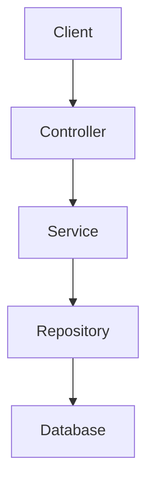

# Creating a Project with IntelliJ IDEA

![[intellij-create-a-project.png|Creating Project]]

## Language

While all three options are JVM-compatible languages, Java remains the primary choice for Spring Boot, with Kotlin gaining widespread adoption due to modern features like null-safety.

- **Java**
- **Kotlin**
- **Groovy**

## Type (Build System)

Choose your build tool and configuration DSL:

- **Gradle - Groovy**: Uses the Groovy DSL for Gradle build scripts.
- **Gradle - Kotlin**: Uses the Kotlin DSL for Gradle build scripts with type-safety and IDE auto-completion.
- **Maven**: Traditional build system with XML configuration.

Modern standard practice frequently adopts **Kotlin + Gradle - Kotlin**.

# Exploring Spring Boot Project Structure

```
my-project/
├── src/
│   ├── main/
│   │   ├── java/
│   │   │   └── com/example/myproject/
│   │   │       ├── MyProjectApplication.java
│   │   │       │
│   │   │       ├── controller/
│   │   │       │   └── PostController.java
│   │   │       │
│   │   │       ├── service/
│   │   │       │   └── PostService.java
│   │   │       │
│   │   │       ├── repository/
│   │   │       │   └── PostRepository.java
│   │   │       │
│   │   │       ├── domain/
│   │   │       │   └── Post.java
│   │   │       │
│   │   │       ├── dto/
│   │   │       │   ├── PostRequest.java
│   │   │       │   └── PostResponse.java
│   │   │       │
│   │   │       └── config/
│   │   │           └── SecurityConfig.java
│   │   │
│   │   └── resources/
│   │       ├── application.yml
│   │       ├── static/
│   │       └── templates/
│   │
│   └── test/
│       └── java/
│
├── build.gradle
├── settings.gradle
└── gradlew
```

## Request Flow



|     Layer     | Responsibility                          |
| :-----------: | --------------------------------------- |
|  Controller   | Handles HTTP requests & responses       |
|    Service    | Business logic execution                |
|  Repository   | Data persistence & database access      |
| Domain/Entity | Core data models & domain logic         |
|      DTO      | Data transfer contracts between layers  |
|    Config     | Spring configuration & bean definitions |

## `MyProjectApplication.java`

> The main entry point of the Spring Boot application

```java
@SpringBootApplication
public class MyProjectApplication {

    public static void main(String[] args) {
        SpringApplication.run(MyProjectApplication.class, args);
    }
}
```

The application class sits at the root package. `@SpringBootApplication` enables component scanning across this package and all nested sub-packages:

```
com.example
└── myproject
    ├── MyProjectApplication.java
    ├── controller
    ├── service
    └── repository
```

## Controller

> The entry layer receiving inbound HTTP requests

```java
@RestController
@RequestMapping("/posts")
public class PostController {

    private final PostService postService;

    public PostController(PostService postService) {
        this.postService = postService;
    }

    @PostMapping
    public PostResponse createPost(
            @RequestBody PostRequest request
    ) {
        return postService.createPost(request);
    }
}
```

Key responsibilities:
- Receives HTTP requests
- URL routing & mapping
- Path variable extraction
- Query parameter binding
- Request body deserialization
- Building HTTP response payloads
- Basic input validation

## Service

> Houses core business logic

```java
@Service
public class PostService {

    private final PostRepository postRepository;

    public PostService(PostRepository postRepository) {
        this.postRepository = postRepository;
    }

    public PostResponse createPost(PostRequest request) {

        Post post = new Post(
            request.title(),
            request.content()
        );

        Post savedPost = postRepository.save(post);

        return PostResponse.from(savedPost);
    }
}
```

For instance, a business rule such as **title length must not exceed 100 characters** should reside in the Service or Domain layer:

```java
if (request.title().length() > 100) {
    throw new IllegalArgumentException("Title is too long.");
}
```

For complex domain logic, encapsulating constraints directly inside the Entity/Domain object is recommended.

## Repository

> The data access layer connecting to the database

With Spring Data JPA, boilerplate implementation is avoided:

```java
public interface PostRepository
        extends JpaRepository<Post, Long> {
}

// Built-in operations provided automatically:
postRepository.save(post);
postRepository.findById(id);
postRepository.findAll();
postRepository.delete(post);
```

## Domain / Entity

> Models the core data and business entities of the application

```java
@Entity
public class Post {

    @Id
    @GeneratedValue
    private Long id;

    private String title;

    private String content;

    // ...
}
```

Rich domain operations can be encapsulated directly on the entity:

```java
public void changeTitle(String title) {

    if (title == null || title.isBlank()) {
        throw new IllegalArgumentException("Title cannot be blank.");
    }

    this.title = title;
}
```

## DTO (Data Transfer Object)

> Objects dedicated to API request and response data contracts

```java
// Request DTO
public record PostRequest(
    String title,
    String content
) {
}

// Response DTO
public record PostResponse(
    Long id,
    String title,
    String content
) {
}

// Usage in Controller
@PostMapping
public PostResponse createPost(
        @RequestBody PostRequest request
) {
    return postService.createPost(request);
}
```

> [!NOTE] Why not return Entities directly?
>
> While returning an entity directly is technically possible:
>
> ```java
> @PostMapping
> public Post createPost(...) {
>     return postService.createPost(...);
> }
> ```
>
> Entities reflect internal database schemas and relationships. Decoupling them with DTOs enables independent evolution of external API contracts and internal data models:
>
> - **Entity** <-> Database schema
> - **DTO** <-> API contract

## Config

> Manages Spring configuration and bean wiring

```java
@Configuration
public class SecurityConfig {

    @Bean
    SecurityFilterChain securityFilterChain(HttpSecurity http)
            throws Exception {

        return http
            .authorizeHttpRequests(auth -> auth
                .anyRequest().authenticated()
            )
            .build();
    }
}
```

## `resources`

> Directory for non-Java application assets and configurations

```
src/main/resources/
├── application.yml
├── static/
├── templates/
└── ...
```

## Testing

```java
class PostServiceTest {

    @Test
    void createPost() {
        // ...
    }
}
```

## Layered Architecture vs. Package by Feature

A standard layered architecture organizes code by technical responsibility. While clear initially, package directories can grow unwieldy as projects expand:

```
com.example.project
├── controller
├── service
├── repository
├── domain
├── dto
└── config
```

> [!TIP] Package by Feature
>
> For larger codebases, grouping by business domain feature promotes higher cohesion and modularity:
>
> ```
> com.example.project/
> ├── user/
> │   ├── User.java
> │   ├── UserController.java
> │   ├── UserService.java
> │   ├── UserRepository.java
> │   └── UserResponse.java
> │
> ├── post/
> │   ├── Post.java
> │   ├── PostController.java
> │   ├── PostService.java
> │   ├── PostRepository.java
> │   ├── PostRequest.java
> │   └── PostResponse.java
> │
> ├── comment/
> │   ├── Comment.java
> │   ├── CommentController.java
> │   ├── CommentService.java
> │   └── CommentRepository.java
> │
> └── config/
>     └── SecurityConfig.java
> ```
