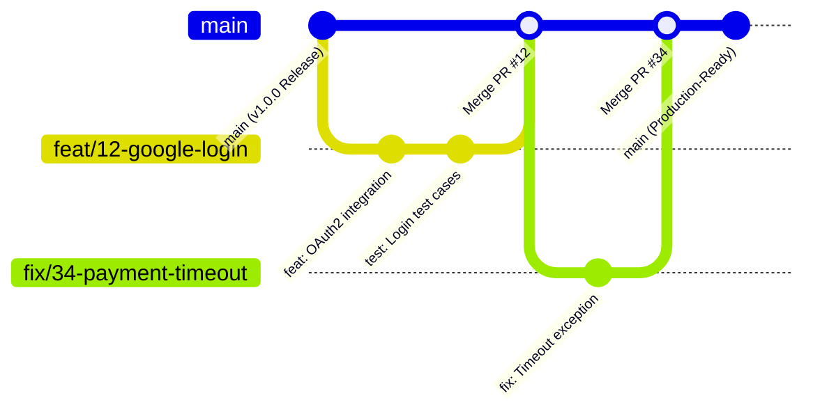

When developing solo, running `git commit -m "fix"`, `git commit -m "done"`, and `git push origin main` rarely causes issues. You are the sole author and reviewer, and all contextual knowledge remains fresh in your head.

However, once two or more teammates collaborate on a shared codebase, Git transitions from a simple backup tool into the core protocol for asynchronous collaboration. In repositories lacking clear conventions, teams often spend far more engineering hours reconstructing historical context and resolving merge conflicts than writing new features.

In this article, we cover the two foundational rules every team should establish first to eliminate fragmented history and reduce collaboration overhead: **Commit Conventions** and **Branching Strategies**.

## 1. Problem Definition: 3 Signs of a Failing Team Repository

Here are three common symptoms engineering teams face in the absence of collaborative conventions.

### ① Context Loss in Commit Logs

```bash
$ git log --oneline -n 5
a1c3e4f fix
8b2d10a update
99f120c final final fix
d410ab2 test
0e45f91 merge
```

When a regression reaches production, even if tools like `git bisect` or `git blame` pinpoint the problematic commit, deciphering the author's original intent or the problem they were attempting to solve is nearly impossible. Engineers must either inspect hundreds of lines in diffs or ping colleagues on Slack hoping someone remembers what happened.

### ② Big-Bang Merges and Endless Conflicts

As branch lifespans lengthen and task scopes balloon, local branches diverge significantly from `main`. After spending two weeks editing dozens of files in isolation, attempting to merge leads to painful conflict markers:

```text
CONFLICT (content): Merge conflict in src/services/auth.ts
Automatic merge failed; fix conflicts and then commit the result.
```

### ③ Release Ambiguity

Questions such as "Does `main` only contain releasable code right now?" or "Is this commit still undergoing QA or an urgent production hotfix?" become ambiguous. Inevitably, sorting out tangled branch histories ends up delaying planned releases.

## 2. Solution 1: Commit Conventions Communicating Clear Intent

A commit message serves as an explanatory rationale for your teammates and your future self months down the road. Standardizing on the widely adopted **Conventional Commits** specification makes asynchronous communication significantly smoother.

### Standard Commit Message Anatomy

```text
<type>(<optional scope>): <subject>

[optional body]

[optional footer(s)]
```

- **Type**: The nature and purpose of the commit (required)
- **Scope**: The modified module or domain (optional, e.g., auth, ui, network)
- **Subject**: Concise single-line summary (required, ~50 characters, imperative mood)
- **Body**: Motivation and context behind the change (optional, focus on 'why' rather than 'what')
- **Footer**: Breaking changes or referenced issue numbers (optional)

### Practical Commit Type Guidelines

Introducing too many types increases cognitive fatigue per commit. In practice, sticking to six core types provides clean categorization:

| Type       | Purpose                                        | Example Changes                           |
| :--------- | :--------------------------------------------- | :---------------------------------------- |
| `feat`     | Adding a new feature                           | Integrate OAuth2 social login API         |
| `fix`      | Bug fixes                                      | Resolve infinite refresh loop on expiry   |
| `refactor` | Code restructuring without behavioral changes  | Clean up redundant API client layers      |
| `chore`    | Build tasks, package configs, and boilerplate  | Add ESLint rules, bump dependency version |
| `style`    | Formatting, semicolons (no logic impact)       | Apply Prettier formatting                 |
| `test`     | Adding or modifying tests                      | Write unit tests for checkout failures    |

### Comparing Bad vs. Good Commit Messages

```bash
# ❌ Bad: Ambiguous intent and bare change listing
git commit -m "fix login error and refactor"

# ⭕ Good: Clear type, scope, and motivation
git commit -m "fix(auth): prevent infinite 401 loop when refresh token expires

Immediately invalidate the local auth session and redirect to the
login screen when token renewal fails."
```

## 3. Solution 2: A Simple, Predictable Branching Strategy (Modified GitHub-Flow)

For early-stage teams or product teams with short release cycles, heavy strategies like traditional Git-Flow (featuring persistent branches like `develop`, `release`, and `hotfix`) introduce excessive synchronization overhead.

In modern web and mobile environments with frequent deployments, a **modified GitHub-Flow** strategy offers superior practicality by maximizing simplicity without compromising stability.

### Branch Topology



1. **`main` Branch**:
   - Always maintained in a production-ready state passing all builds and test suites.
   - Direct pushes to `main` are strictly blocked via Branch Protection Rules.
2. **Feature / Fix Branches**:
   - Every task branches off from the latest `main`.
   - Branches remain short-lived (ideally under 2–3 days) to minimize merge conflict risks.

### Consistent Branch Naming Scheme

Combine type prefixes and issue numbers to make each branch's scope immediately recognizable:

```text
<type>/#<issue-number>-<kebab-case-description>
```

- **Feature Development**: `feat/#12-social-auth`
- **Bug Fix**: `fix/#45-token-refresh`
- **Configuration & Maintenance**: `chore/#88-ci-pipeline`

## 4. Structural Impact & Comparison

Here is how key collaboration metrics transform before and after establishing these rules:

| Metric                           | Before (Ad-hoc)                                         | After (Convention & GitHub-Flow)                                |
| :------------------------------- | :------------------------------------------------------ | :-------------------------------------------------------------- |
| **Root Cause Tracing (`blame`)** | Requires digging through Slack / docs due to bare logs  | Over 90% of change context understood from commit title & body  |
| **Merge Conflict Frequency**     | Frequent massive conflicts due to prolonged branch life | Conflict surface localized through short-lived feature branches |
| **Deployment Stability**         | High overhead filtering deployable commits              | `main` is always deployable, validated by automated CI checks   |

## 5. Practical Tip: Documenting Workflows for AI Agents and Teammates (AGENTS.md & docs)

Modern engineering teams increasingly collaborate with AI coding agents (such as Claude Code, Codex, or Antigravity). Without explicit guidance, agents tend to generate vague commits like `update` or `fix bug`, cluttering the project's Git history.

Rather than repeating "Please strictly follow Conventional Commits" in every prompt, declaring the conventions in `AGENTS.md` or `docs/git-workflow.md` at the repository root ensures AI agents automatically ingest and follow them before taking action.

### ① Single Source of Truth (SSOT) Architecture

Maintain a lean document structure so both human engineers and AI agents consult the exact same standards:

```text
my-project/
├── AGENTS.md               # Entry point for AI agents (or CLAUDE.md)
└── docs/
    └── git-workflow.md     # Single Source of Truth for team-wide Git conventions
```

- **`docs/git-workflow.md`**: The official guide documenting commit types, branch naming, and PR processes.
- **`AGENTS.md`**: The primary entry file read by AI agents upon task initialization, summarizing rules or referencing `docs/git-workflow.md`.

### ② Sample `AGENTS.md` for AI Agents

Define clear constraints for agents managing commits and branches:

```markdown
# Git & Contribution Guidelines for AI Agents

When performing Git operations (branching, committing, making PRs), strictly follow our team conventions:

## 1. Branch Naming

- Always branch off from the latest `main`.
- Use the format: `<type>/#<issue-number>-<short-description>`
  - Examples: `feat/#18-oauth-login`, `fix/#42-token-refresh`

## 2. Commit Message Convention

- Follow Conventional Commits: `<type>(<scope>): <subject>`
- Allowed types: `feat`, `fix`, `refactor`, `chore`, `style`, `test`, `docs`
- Rules:
  - Subject: Imperative, concise (under 50 chars), no period at the end.
  - Body: Explain _why_ the change is necessary, not just _what_ was done.
  - Keep commits atomic (one logical change per commit).
  - NEVER use vague commit messages (e.g., "wip", "update", "fix bug").

For detailed rules and examples, refer to `docs/git-workflow.md`.
```

### ③ Combining Guidance with Automated Safety Nets

`AGENTS.md` acts as proactive guidance helping agents formulate compliant changes upfront. Pairing this with client-side Git hooks like `husky` and `commitlint` establishes an enforceable post-validation safety net that catches human and AI oversights directly in the terminal before they reach the remote repository.

---

## Related Guides

- [[git-workflow-2|Git Collaboration - From Issues to Merging with GitHub Workflow]]: Covers the end-to-end workflow from creating issues, branching, PR templates, and auto-closing keywords to Squash and Merge.
