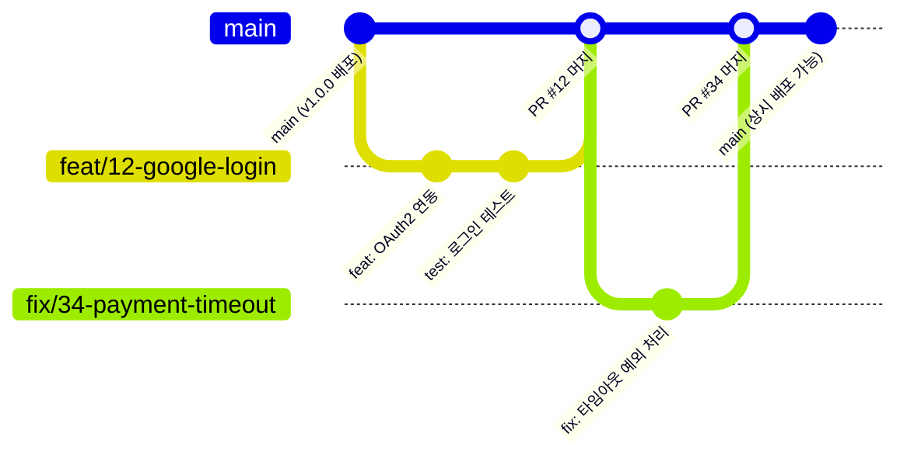

혼자 개발할 때는 `git commit -m "fix"`, `git commit -m "수정완료"`, `git push origin main`만 써도 큰 문제가 없습니다. 내가 유일한 작업자이자 리뷰어이고, 코드 맥락도 머릿속에 온전히 남아있기 때문입니다.

하지만 둘 이상의 팀원이 한 코드베이스에서 작업하기 시작하면 Git은 단순한 백업 도구를 넘어 비동기 협업의 중심 프로토콜이 됩니다. 명확한 규칙이 없는 저장소에서는 새 코드를 짜는 시간보다 변경 맥락을 역추적하고 충돌을 해결하는 데 훨씬 더 많은 리소스가 들어갑니다.

이번 글에서는 코드 히스토리가 파편화되는 문제를 막고 협업 비용을 낮추기 위해 팀이 가장 먼저 맞춰야 할 두 가지 규칙, 커밋 컨벤션과 브랜치 전략을 정리합니다.

## 1. 문제 정의: 팀 저장소가 무너지는 3가지 징후

협업 규칙이 없을 때 흔히 겪는 세 가지 문제입니다.

### ① 맥락이 증발한 커밋 로그 (Context Loss)

```bash
$ git log --oneline -n 5
a1c3e4f fix
8b2d10a update
99f120c 진짜 최종 수정
d410ab2 test
0e45f91 merge
```

프로덕션에 버그가 배포됐을 때 `git bisect`나 `git blame`으로 문제 지점을 찾아내더라도, 그 커밋이 어떤 의도로 어떤 문제를 풀려 했는지 알기 어렵습니다. 결국 수백 줄의 코드 diff를 일일이 뜯어보거나, 슬랙으로 작성자에게 당시 기억을 되살려달라고 부탁해야 합니다.

### ② 빅뱅 머지(Big-Bang Merge)와 반복되는 충돌

브랜치 수명이 길어지고 작업 단위가 커질수록 각자의 로컬 브랜치는 `main`과 점점 멀어집니다. 2주 동안 혼자 수십 개 파일을 고친 뒤 머지하려는 순간, 감당하기 어려운 충돌(Conflict) 마커를 마주하게 됩니다.

```text
CONFLICT (content): Merge conflict in src/services/auth.ts
Automatic merge failed; fix conflicts and then commit the result.
```

### ③ 릴리스 시점의 불확실성

"현재 `main` 브랜치에 배포 가능한 기능만 들어가 있는가?", "이 커밋은 아직 QA 중인 코드인가, 배포 완료된 핫픽스인가?" 같은 기준이 흐려집니다. 결국 복잡한 브랜치를 정리하느라 배포 일정까지 밀리게 됩니다.

## 2. 해결책 1: 명확한 의도를 전달하는 커밋 컨벤션

커밋 메시지는 팀원과 몇 달 뒤의 나에게 남기는 변경 사유서입니다. 널리 쓰이는 Conventional Commits 규격을 기준으로 팀 표준을 잡으면 의사소통이 훨씬 수월해집니다.

### 커밋 메시지 기본 구조

```text
<type>(<optional scope>): <subject>

[optional body]

[optional footer(s)]
```

- **Type**: 커밋의 성격과 목적 (필수)
- **Scope**: 변경 모듈이나 도메인 (선택, 예: auth, ui, network)
- **Subject**: 변경 사항 한 줄 요약 (필수, 50자 내외, 개조식으로 작성)
- **Body**: 변경 이유와 맥락 설명 (선택, '무엇을'보다 '왜'에 집중)
- **Footer**: 주요 변경(Breaking Changes)이나 연관 이슈 번호 (선택)

### 실전 커밋 타입 가이드라인

타입이 너무 많으면 커밋할 때마다 피로감이 커집니다. 실무에서는 자주 쓰는 6가지 핵심 타입 위주로 명확히 나누어 쓰는 편이 좋습니다.

| Type       | 대상 및 목적                                  | 변경 예시                              |
| :--------- | :-------------------------------------------- | :------------------------------------- |
| `feat`     | 새로운 기능 추가                              | OAuth2 소셜 로그인 API 연동            |
| `fix`      | 버그 수정                                     | 토큰 만료 시 무한 리프레시 루프 해결   |
| `refactor` | 기능 변경 없는 코드 구조 개선                 | 중복 API 호출 레이어 정리              |
| `chore`    | 빌드 작업, 패키지 매니저 설정, 보일러플레이트 | ESLint 규칙 추가, 의존성 버전 업데이트 |
| `style`    | 코드 동작에 영향 없는 포맷팅, 세미콜론 누락   | Prettier 자동 정렬 적용                |
| `test`     | 테스트 코드 추가 또는 기존 테스트 수정        | 결제 실패 시나리오 단위 테스트 작성    |

### Bad vs Good 커밋 메시지 비교

```bash
# ❌ Bad: 모호한 의도와 단순 변경 사항 나열
git commit -m "로그인 에러 고침 및 리팩토링"

# ⭕ Good: 명확한 타입, 스코프, 변경 동기 전달
git commit -m "fix(auth): 만료된 리프레시 토큰 처리 시 401 무한 루프 수정

액세스 토큰 갱신 실패 시 로컬 스토리지의 인증 세션을 즉시 파기하고
로그인 화면으로 리다이렉트하도록 인터셉터 분기 추가."
```

## 3. 해결책 2: 단순하고 예측 가능한 브랜치 전략 (GitHub-Flow 변형)

초기 팀이나 릴리스 주기가 짧은 제품 조직에서는 Git-Flow처럼 `develop`, `release`, `hotfix` 등 영구 브랜치가 많은 구조가 오히려 동기화 부담을 키웁니다.

빠르게 배포하는 현대 웹·앱 환경에서는 안정성을 챙기면서 복잡도를 낮춘 GitHub-Flow 변형 전략이 훨씬 실용적입니다.

### 브랜치 토폴로지 (Branch Topology)



1. **main 브랜치**:
   - 항상 빌드와 테스트를 통과하는 배포 가능 상태(Production-Ready)를 유지합니다.
   - `main` 브랜치 직접 푸시는 브랜치 보호 규칙(Branch Protection Rule)으로 막아둡니다.
2. **Feature / Fix 브랜치**:
   - 모든 작업은 `main`에서 브랜치를 따며 시작합니다.
   - 수명이 2~3일을 넘지 않는 단기(Short-lived) 브랜치로 유지해 충돌 위험을 줄입니다.

### 일관된 브랜치 네이밍 규칙

이름만 보고도 작업 내용과 관련 이슈를 바로 알아볼 수 있도록 접두사와 티켓 번호를 조합합니다.

```text
<type>/#<issue-number>-<kebab-case-description>
```

- **기능 개발**: `feat/#12-social-auth`
- **버그 수정**: `fix/#45-token-refresh`
- **환경 설정 및 유지보수**: `chore/#88-ci-pipeline`

## 4. 구조적 개선 효과

규칙 도입 전후의 협업 병목 변화를 비교하면 다음과 같습니다.

| 평가 항목                        | 도입 전 (Ad-hoc)                                 | 도입 후 (Convention & GitHub-Flow)                    |
| :------------------------------- | :----------------------------------------------- | :---------------------------------------------------- |
| **장애 원인 추적 (`git blame`)** | 무의미한 커밋 메시지로 인해 Slack/문서 검색 필요 | 커밋 제목과 본문만으로 변경 배경과 의도 90% 이상 파악 |
| **머지 충돌 빈도**               | 긴 브랜치 수명으로 인해 대규모 수동 해소 빈번    | 이슈 단위 Short-lived 브랜치로 충돌 범위 국소화       |
| **배포 안정성**                  | 배포 가능한 커밋 선별에 리소스 소모              | `main`은 상시 배포 가능, CI 테스트 자동 검증          |

## 5. 실전 팁: AI 에이전트와 팀원을 위한 워크플로우 문서화 (AGENTS.md & docs)

요즘은 팀원뿐만 아니라 Claude Code, Codex 같은 AI 코딩 에이전트가 직접 작업을 하는 경우가 많습니다. 하지만 에이전트에게 팀 규칙을 미리 알려주지 않으면 `update`, `fix bug` 같은 무의미한 커밋을 남기거나 제멋대로 브랜치를 만들어 히스토리를 어지럽히기 쉽습니다.

매번 프롬프트에 "Conventional Commits 꼭 지켜줘"라고 쓸 필요 없이, 저장소 루트의 `AGENTS.md`나 `docs/git-workflow.md`에 규칙을 적어두면 에이전트가 작업을 시작할 때 이를 자연스럽게 읽고 따릅니다.

### ① 단일 진실 공급원(SSOT) 아키텍처

팀원과 AI 모두 같은 기준을 보게끔 문서 구조를 단순하게 가져갑니다.

```text
my-project/
├── AGENTS.md               # AI 에이전트가 읽는 진입 규칙 (또는 CLAUDE.md)
└── docs/
    └── git-workflow.md     # 팀 전체의 Git 컨벤션 단일 진실 공급원 (SSOT)
```

- **`docs/git-workflow.md`**: 앞서 정리한 커밋 타입, 브랜치 명명 규칙, PR 절차를 기록한 팀의 공식 가이드입니다.
- **`AGENTS.md`**: AI 에이전트가 작업을 시작할 때 가장 먼저 읽는 진입 파일입니다. 핵심 규칙을 요약해 두거나 `docs/git-workflow.md`를 참고하도록 연결합니다.

### ② AI 에이전트를 위한 `AGENTS.md` 작성 예시

에이전트가 커밋과 브랜치를 다룰 때 지켜야 할 제약 조건을 간결하고 명확하게 적어둡니다.

```markdown
# Git & Contribution Guidelines for AI Agents

When performing Git operations (branching, committing, making PRs), strictly follow our team conventions:

## 1. Branch Naming

- Always branch off from the latest `main`.
- Use the format: `<type>/#<issue-number>-<short-description>`
  - Examples: `feat/#18-oauth-login`, `fix/#42-token-refresh`

## 2. Commit Message Convention

- Follow Conventional Commits: `<type>(<scope>): <subject>`
- Allowed types: `feat`, `fix`, `refactor`, `chore`, `style`, `test`, `docs`
- Rules:
  - Subject: Imperative, concise (under 50 chars), no period at the end.
  - Body: Explain _why_ the change is necessary, not just _what_ was done.
  - Keep commits atomic (one logical change per commit).
  - NEVER use vague commit messages (e.g., "wip", "update", "fix bug").

For detailed rules and examples, refer to `docs/git-workflow.md`.
```

### ③ 사전 가이드와 사후 검증의 시너지

`AGENTS.md`는 에이전트가 처음부터 의도한 규칙에 맞춰 작업하게 돕는 사전 가이드(Guidance)입니다. 여기에 `husky`나 `commitlint` 같은 Git Hook을 함께 활용하면, 사람이나 에이전트의 실수를 터미널 단계에서 최종적으로 걸러내는 사후 안전망(Safety Net)이 됩니다.

---

## 연관 가이드

- [[git-workflow-2|Git 협업 - 이슈에서 머지까지 GitHub 워크플로우]]: 이슈 등록부터 브랜치 분기, PR 템플릿 작성, Auto-close 키워드 연동 및 Squash and Merge까지 이어지는 워크플로우를 다룹니다.
