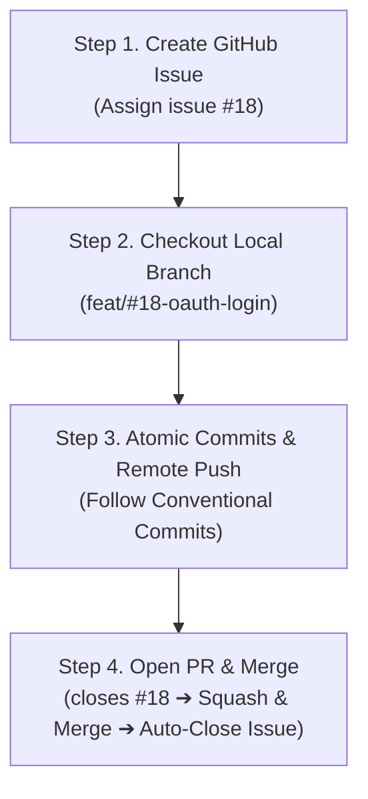

Once you establish [[git-workflow-1|Commit Conventions and Branching Strategies]], the next step is building an end-to-end pipeline that turns those principles into a frictionless daily workflow on GitHub.

Engineering productivity depends just as much on how smoothly your team executes the development loop—**Requirements Definition ➔ Branch Creation ➔ Code Review ➔ Main Branch Merging**—as on raw coding speed.

## 1. Three Bottlenecks in GitHub Collaboration

Teams operating without standardized templates and platform-level automation routinely encounter three major bottlenecks:

### ① Incomplete Issues and Communication Ping-pong

```markdown
# Title: Login error occurs

# Body:

Getting a 500 error when trying to log in. Please check.
```

An issue filed without environment details (OS, device, browser version), reproduction steps, expected behavior, or stack traces leaves engineers stuck. After exchanging multiple rounds of questions on Slack or comment threads ("Which test account did you use?", "Can you share the console logs?"), hours evaporate before anyone even begins diagnosing the issue.

### ② Disconnect Between Tickets and Code (Lack of Traceability)

Without automated linking, engineers must manually track which PR fulfills which requirement, and whether issues were closed after deployment. All too often, tickets remain open long after the corresponding code was deployed—or PRs appear without context, forcing reviewers to navigate hundreds of lines of diffs blind.

### ③ Uncontrolled Flooding of 'WIP Commits' into Main

When temporary local commits like `wip`, `temp`, or `typo fix` enter the `main` branch alongside merge commits, the repository history quickly degrades into visual noise. Later on, rolling back features or cherry-picking isolated fixes becomes an error-prone ordeal.

## 2. GitHub Template Architecture Eliminating Unnecessary Friction

By adding a `.github/` directory at the repository root, issue and pull request creation forms are automatically populated with structured templates:

```text
.github/
├── ISSUE_TEMPLATE/
│   ├── feature_request.md
│   └── bug_report.md
└── PULL_REQUEST_TEMPLATE.md
```

### ① Bug Report Template (`.github/ISSUE_TEMPLATE/bug_report.md`)

```markdown
---
name: Bug Report
about: Create a report to help us solve the problem.
title: "[BUG] "
labels: bug
assignees: ""
---

## 🐛 Bug Description

A clear and concise description of what the bug is.

## 📱 Environment

- OS: [e.g. macOS 14.5, iOS 17.4, Windows 11]
- Browser / Client: [e.g. Chrome 124, Safari]
- Version: [e.g. v1.2.0]

## 🔄 Reproduction Steps

1. Navigate to '...'
2. Click on '...'
3. See error: '...'

## 📋 Expected Behavior

A clear description of what you expected to happen.

## 📸 Screenshots / Logs (Optional)
```

### ② Feature Request Template (`.github/ISSUE_TEMPLATE/feature_request.md`)

```markdown
---
name: Feature Request
about: Propose a new feature or task.
title: "[FEAT] "
labels: enhancement
assignees: ""
---

## 🚀 Overview

Describe the goal and motivation for the requested feature.

## 📌 Requirements & Checklist (To-Do)

- [ ] Core requirement 1
- [ ] Core requirement 2
- [ ] Exception handling & error states

## 💡 References

- Figma links, API specifications, etc.
```

### ③ Pull Request Template (`.github/PULL_REQUEST_TEMPLATE.md`)

Provide reviewers with immediate context and scope before they begin inspecting code diffs:

```markdown
## 📌 Related Issue

> closes #issue-number (or resolves #issue-number)

## 📝 Summary of Changes

- Summarize key implementations or fixes using bullet points.
- Highlight rationale and important architectural decisions.

## 📸 Screenshots / UI Before & After (Optional)

|    Before     |     After     |
| :-----------: | :-----------: |
| (Attach img)  | (Attach img)  |

## 🧪 Verification & Test Results

- [ ] Unit tests added / passing
- [ ] Verified locally with integration testing

## 💬 Reviewer Notes

- Highlight areas where targeted feedback or caution is requested.
```

## 3. The 4-Step GitHub Workflow

With templates in place, connect the cycle from issue creation to final merge:



### Step 1. Issue Creation and Number Assignment

- Navigate to the **Issues** tab in your repository, click **New Issue**, and pick the appropriate template.
- Specify requirements as an actionable checklist. Upon submission, a unique issue number (e.g., `#18`) is generated.

### Step 2. Branch Checkout Based on Issue Number

- Synchronize your local `main` branch with remote upstream, then branch out incorporating the assigned issue number:

```bash
# 1. Update local main
$ git checkout main
$ git pull origin main

# 2. Branch off using issue number
$ git checkout -b feat/#18-oauth-login
```

### Step 3. Implementation and Atomic Commits

- Commit changes in logical, atomic increments adhering to your team's [[git-workflow-1|commit conventions]], then push to the remote repository:

```bash
$ git commit -m "feat(auth): initialize Kakao social login SDK and session issuance"
$ git commit -m "test(auth): add unit test handling social login failure cases"

# Push to remote branch
$ git push -u origin feat/#18-oauth-login
```

### Step 4. PR Creation and Automatic Issue Linking (Auto-close)

- Opening a PR on GitHub automatically loads your pre-configured PR template.
- Reference the ticket in the first section using auto-closing syntax:

```markdown
## 📌 Related Issue

closes #18
```

> [!NOTE]
> **GitHub Auto-Close Keywords**
> `close`, `closes`, `closed`, `fix`, `fixes`, `fixed`, `resolve`, `resolves`, `resolved`
> Placing one of these keywords directly before `#issue-number` (e.g., `closes #18`) automatically closes the linked issue the moment the PR is merged into the default branch (`main`).

## 4. Structural Impact & Comparison

| Area / Indicator                 | Before (Manual)                                            | After (Templates + Automation)                             |
| :------------------------------- | :--------------------------------------------------------- | :--------------------------------------------------------- |
| **Issue Triage & Reproduction**  | Missing context causes 3–4 rounds of back-and-forth        | Mandatory environment & reproduction data enables immediate work |
| **Issue Lifecycle Management**   | Many orphaned issues left open after code merges           | 100% automated closing upon PR merge                       |
| **Code Review Velocity**         | Reviewers must decipher change context from raw diffs alone | Context grasped in 5 minutes via summaries, screenshots & tests |

## 5. Practical Deep Dive: 2 Protections for a Clean, Safe Main Branch

Even a well-architected workflow can break down if merge practices and branch permissions are left unmanaged.

### ① Merge Strategy: Practical Benefits of 'Squash and Merge'

Among GitHub's merge options, **Squash and Merge** provides the cleanest and safest history for standard feature development:

```text
Feature Branch:  A ── B ── C (wip, typo fix, and 3 local commits)
                              │
                    [Squash and Merge]
                              ▼
Main Branch:    ───── X ───── [feat: integrate Kakao social login (#18)] ─────
```

- **History Simplification:** Consolidates local micro-commits and typo fixes into a single clean commit on `main`.
- **Traceability:** Automatically appends the PR number to the commit message (e.g., `(#18)`), enabling instant context retrieval from `git log`.

### ② Configuring Branch Protection Rules

To prevent accidental regressions, navigate to **Settings > Branches > Branch protection rules** and enforce these three rules on `main`:

1. **Require a pull request before merging:** Blocks direct pushes (`git push origin main`).
2. **Require approvals (minimum 1):** Prevents merging without peer review and approval.
3. **Require status checks to pass before merging:** Ensures CI builds and automated test suites pass before allowing a merge.

## Conclusion

Conventions and templates are never meant to constrain developers. Rather, they serve as foundational guardrails that eliminate repetitive friction like "Why was this code written this way?", empowering engineering teams to stay focused on solving core product challenges.
