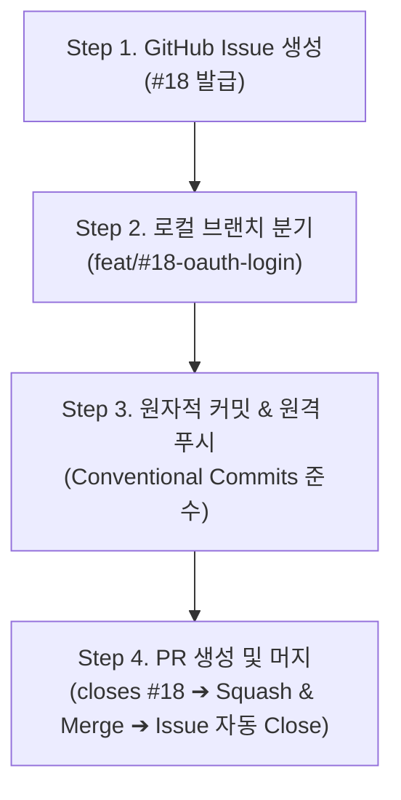

[[git-workflow-1|커밋 컨벤션과 브랜치 전략]]을 세웠다면, 이제 이 규칙이 GitHub 환경에서 하나의 매끄러운 개발 흐름으로 굴러가도록 만드는 실전 파이프라인이 필요합니다.

팀 프로젝트의 생산성은 코드를 짜는 시간 못지않게 '요구사항 정의 ➔ 브랜치 생성 ➔ 코드 리뷰 ➔ 메인 브랜치 병합'으로 이어지는 주기를 얼마나 매끄럽고 빠르게 굴릴 수 있는지에 달려 있습니다.

## 1. GitHub 협업의 3가지 병목

플랫폼 수준의 자동화와 표준 템플릿이 없는 팀은 다음과 같은 문제를 자주 겪습니다.

### ① 불완전한 이슈 번호과 커뮤니케이션 핑퐁

```markdown
# Title: 로그인 에러 납니다

# Body:

로그인 시도시 500 에러 떠요. 확인 부탁드립니다.
```

재현 환경(OS, 기기 및 브라우저 버전), 발생 조건, 기대 동작, 에러 로그가 빠진 이슈는 작업자를 막막하게 만듭니다. 슬랙이나 댓글로 "어떤 계정으로 테스트하셨나요?", "콘솔 로그 캡처 부탁드립니다" 같은 질문을 서너 번 주고받다 보면, 정작 문제 해결은 시작도 못 한 채 몇 시간이 훌쩍 지나갑니다.

### ② 티켓과 코드 변경의 단절 (추적성 결여)

어떤 PR이 무슨 요구사항 때문에 올라왔는지, 배포 후 해당 이슈가 잘 닫혔는지 일일이 직접으로 확인해야 합니다. 이슈는 열려 있는데 코드는 이미 머지되어 있거나, 반대로 설명 없는 PR만 덜렁 올라와 리뷰어가 수백 줄의 코드를 맥락 없이 헤매는 일이 생깁니다.

### ③ 'WIP 커밋'의 무분별한 메인 유입

작업 도중 남긴 `wip`, `temp`, `typo fix` 같은 임시 커밋들이 merge commit과 함께 그대로 `main` 브랜치에 섞여 들어가면 Git 히스토리는 순식간에 지저분해집니다. 나중에 특정 기능 단위로 변경 사항을 되돌리거나 체리픽(Cherry-pick)하기도 아주 번거로워집니다.

## 2. 불필요한 질문 비용을 없애는 GitHub 템플릿 아키텍처

저장소 루트에 `.github/` 디렉터리를 만들고 템플릿을 넣어두면, 이슈를 등록하거나 PR을 열 때 필요한 서식이 자동으로 채워집니다.

```text
.github/
├── ISSUE_TEMPLATE/
│   ├── feature_request.md
│   └── bug_report.md
└── PULL_REQUEST_TEMPLATE.md
```

### ① 버그 리포트 템플릿 (`.github/ISSUE_TEMPLATE/bug_report.md`)

```markdown
---
name: Bug Report
about: 버그를 보고하여 문제 해결을 돕습니다.
title: "[BUG] "
labels: bug
assignees: ""
---

## 🐛 버그 설명

어떤 버그인지 간결하게 설명해주세요.

## 📱 발생 환경

- OS: [e.g. macOS 14.5, iOS 17.4, Windows 11]
- Browser / Client: [e.g. Chrome 124, Safari]
- Version: [e.g. v1.2.0]

## 🔄 재현 경로

1. '...' 페이지로 이동합니다.
2. '...' 버튼을 클릭합니다.
3. 다음 에러가 발생합니다.

## 📋 기대 동작 (Expected)

정상적으로 작동했을 때 기대되는 동작을 기술합니다.

## 📸 스크린샷 / 로그 (선택)
```

### ② 기능 요청 템플릿 (`.github/ISSUE_TEMPLATE/feature_request.md`)

```markdown
---
name: Feature Request
about: 새로운 기능 제안 및 태스크 정의
title: "[FEAT] "
labels: enhancement
assignees: ""
---

## 🚀 기능 개요

추가하려는 기능의 목적과 배경을 설명해주세요.

## 📌 상세 요구사항 (To-Do)

- [ ] 기능 세부 항목 1
- [ ] 기능 세부 항목 2
- [ ] 예외 처리 및 에러 핸들링

## 💡 참고 자료 / 레퍼런스

- Figma 링크, API 문서 등
```

### ③ 풀 리퀘스트 템플릿 (`.github/PULL_REQUEST_TEMPLATE.md`)

리뷰어가 코드를 뜯어보기 전에 변경 배경과 영향도를 빠르게 파악할 수 있도록 서식을 잡아줍니다.

```markdown
## 📌 연관된 이슈

> closes #이슈번호 (또는 resolves #이슈번호)

## 📝 작업 내용

- 이번 PR에서 구현하거나 수정한 핵심 내용을 불렛포인트로 요약합니다.
- 변경 사유와 주요 설계 결정 사항을 기술합니다.

## 📸 스크린샷 / UI 변경 전·후 (선택)

|    Before     |     After     |
| :-----------: | :-----------: |
| (이미지 첨부) | (이미지 첨부) |

## 🧪 테스트 결과 및 검증 방법

- [ ] 단위 테스트 작성 및 통과 여부
- [ ] 로컬 환경 통합 테스트 확인

## 💬 리뷰 요구사항

- 특정 로직이나 구조에서 팀원의 집중 검토가 필요한 부분을 적습니다.
```

## 3. GitHub 워크플로우 4단계

템플릿을 갖췄다면 이제 이슈 생성부터 머지까지 이어지는 흐름을 하나로 연결할 차례입니다.



### Step 1. Issue 생성과 번호 획득

- GitHub 저장소의 Issues 탭에서 **New Issue**를 누르고 상황에 맞는 템플릿을 고릅니다.
- 해야 할 일을 체크리스트로 구체화해 등록하면 고유 이슈 번호(예: `#18`)가 발급됩니다.

### Step 2. 이슈 번호 기반 브랜치 체크아웃

- 로컬의 `main` 브랜치를 최신으로 당겨온 뒤, 발급된 이슈 번호를 붙여 새 브랜치를 분기합니다.

```bash
# 1. main 최신화
$ git checkout main
$ git pull origin main

# 2. 이슈 번호 기반 브랜치 생성 및 전환
$ git checkout -b feat/#18-oauth-login
```

### Step 3. 구현 및 원자적 커밋

- [[Git 협업 - 커밋 컨벤션과 브랜치 전략|커밋 컨벤션]] 규칙에 맞춰 의미 있는 논리적 단위(원자적 커밋)로 작업을 나누어 커밋하고 원격 저장소에 푸시합니다.

```bash
$ git commit -m "feat(auth): 카카오 소셜 로그인 SDK 초기화 및 세션 발급 로직 구현"
$ git commit -m "test(auth): 소셜 로그인 실패 케이스 핸들링 단위 테스트 추가"

# 원격 브랜치로 푸시
$ git push -u origin feat/#18-oauth-login
```

### Step 4. PR 생성과 이슈 자동 연동 (Auto-close)

- GitHub에서 PR을 열면 준비해 둔 템플릿이 자동으로 나타납니다.
- 본문 첫 줄에 이슈 연동 키워드를 적어줍니다.

```markdown
## 📌 연관된 이슈

closes #18
```

> **GitHub 이슈 자동 닫기(Auto-Close) 키워드**
> `close`, `closes`, `closed`, `fix`, `fixes`, `fixed`, `resolve`, `resolves`, `resolved`
> 키워드 뒤에 `#이슈번호`를 함께 적어두면(예: `closes #18`), PR이 기본 브랜치(`main`)에 머지되는 즉시 연결된 이슈도 자동으로 닫힙니다.

## 4. 구조적 개선 효과 (Impact)

| 지표 / 영역                | 도입 전 (수동 관리)                                  | 도입 후 (템플릿 + 자동 연동)                              |
| :------------------------- | :--------------------------------------------------- | :-------------------------------------------------------- |
| **이슈 재현 및 확인 시간** | 정보가 부족해 평균 3~4회 질문 핑퐁 발생              | 재현 환경과 경로를 필수 기재하여 등록 즉시 작업 착수 가능 |
| **이슈 라이프사이클 관리** | 코드 머지 후에도 닫히지 않고 방치되는 유령 이슈 다수 | PR 머지와 동시에 100% 자동 Closing                        |
| **코드 리뷰 속도**         | 변경 배경을 이해하려 전체 diff를 거꾸로 역추적       | 요약·스크린샷·테스트 결과 덕분에 5분 만에 작업 맥락 파악  |

## 5. 실무 딥다이브: 안전한 메인 브랜치를 만드는 2가지 보호 장치

워크플로우를 잘 설계해도 머지 방식과 브랜치 접근 권한이 설정이 잘 되어 있지 않으면 메인 브랜치는 쉽게 오염될 수 있습니다.

### ① Merge 전략: 'Squash and Merge'의 실무적 이점

GitHub이 지원하는 세 가지 머지 옵션 중 일반적인 기능 개발에는 `Squash and Merge`가 가장 깔끔하고 안전합니다.

```text
Feature 브랜치:  A ── B ── C (wip, typo fix 등 로컬 작업 내역 3개)
                              │
                    [Squash and Merge]
                              ▼
Main 브랜치:    ───── X ───── [feat: 카카오 소셜 로그인 연동 (#18)] ─────
```

- **히스토리 단순화:** 자잘한 오타 수정이나 임시 커밋을 하나로 묶어, `main`에는 깔끔한 단일 커밋으로 남깁니다.
- **추적성 확보:** 커밋 제목 끝에 `(#18)`처럼 PR 번호가 자동으로 붙어, 나중에 `git log`만 봐도 어떤 작업에서 비롯된 변경인지 바로 알 수 있습니다.

### ② Branch Protection Rules 설정

실수를 미리 방지하려면 저장소 **Settings > Branches > Branch protection rules**에서 `main` 브랜치에 다음 세 가지 보호 규칙을 켜두는 것이 좋습니다.

1. **Require a pull request before merging:** `main` 브랜치 직접 푸시(`git push origin main`) 차단
2. **Require approvals (최소 1명 이상):** 동료 엔지니어의 코드 승인(Approve) 없이는 머지 불가
3. **Require status checks to pass before merging:** CI 빌드와 테스트를 통과해야만 머지 허용

## 마치며

협업 규칙과 템플릿의 목적은 팀원을 통제하거나 구속하는 데 있지 않습니다. "이 코드를 왜 이렇게 짰는가?"를 묻고 확인하는 과정을 최소화하고, 팀이 제품의 본질적인 문제 해결에 집중하도록 돕는 최소한의 안전장치입니다.
