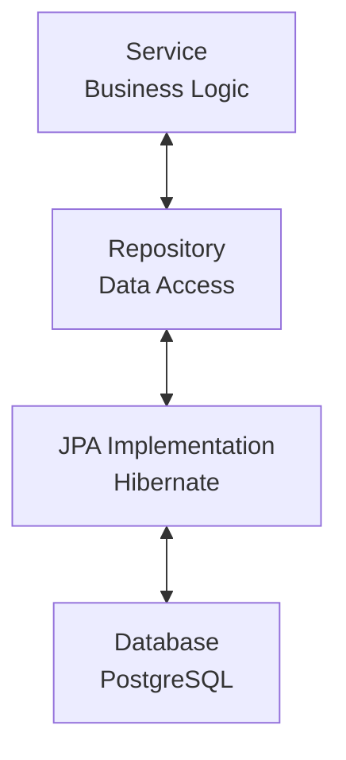

![[thumbnail.png]]

# What is Spring Data JPA?



- **JPA (Java Persistence API)**: Standard API specification for mapping Java objects to relational databases (ORM).
- **Hibernate**: The primary ORM framework implementing the JPA specification.
- **Spring Data JPA**: An abstraction layer providing repository-centric data access to make JPA significantly easier to use.

# Exploring with Code

## `Entity`

- Annotating a class with `@Entity` marks it as a managed JPA entity.
- `@Id` designates the primary key field.
- `@GeneratedValue` defines the primary key generation strategy.
- `GenerationType.IDENTITY` delegates ID auto-increment generation to the underlying database.

### AS-IS (Plain Java Object)

```java
public class Post {
	private Long id;
	private String title;
	private String content;

	public Post(Long id, String title, String content) {
		this.id = id;
		this.title = title;
		this.content = content;
	}

	public Long getId() {
		return id;
	}

	public String getTitle() {
		return title;
	}

	public String getContent() {
		return content;
	}

	public void update(String title, String content) {
		this.title = title;
		this.content = content;
	}
}
```

### TO-BE (JPA Entity)

```java
import jakarta.persistence.Entity;
import jakarta.persistence.GeneratedValue;
import jakarta.persistence.GenerationType;
import jakarta.persistence.Id;

@Entity
public class Post {
	@Id
	@GeneratedValue(strategy = GenerationType.IDENTITY)
	private Long id;
	private String title;
	private String content;

	protected Post() {}

	public Post(String title, String content) {
		this.title = title;
		this.content = content;
	}

	public Long getId() {
		return id;
	}

	public String getTitle() {
		return title;
	}

	public String getContent() {
		return content;
	}

	public void update(String title, String content) {
		this.title = title;
		this.content = content;
	}
}
```

## `Repository`

- Extends standard interfaces with `JpaRepository<Entity, ID>`.
- `JpaRepository` provides built-in CRUD operations out of the box without boilerplate implementations.

### AS-IS

```java
import java.util.List;

public interface PostRepository {
	Post findById(int id);

	List<Post> findAll();

	void save(Post post);

	void delete(Post post);
}

@Repository
public class PostRepositoryImpl implements PostRepository { ... }
```

### TO-BE

```java
import org.springframework.data.jpa.repository.JpaRepository;

public interface PostRepository extends JpaRepository<Post, Long> {}
```

# Core Methods

> [!NOTE] Create/Update `save()`
>
> ```java
> Post post = new Post("Title", "Content");
> postRepository.save(post);
> ```

> [!NOTE] Read `findById()`
>
> ```java
> Optional<Post> post = postRepository.findById(1L);
> ```

> [!NOTE] Read `findAll()`
>
> ```java
> List<Post> posts = postRepository.findAll();
> ```

> [!NOTE] Delete `delete()`
>
> ```java
> postRepository.delete(post);
> ```

For further methods, refer to the [official Spring documentation](https://docs.spring.io/spring-data/jpa/docs/current/api/org/springframework/data/jpa/repository/JpaRepository.html).

# Query Methods

Spring Data JPA generates SQL queries automatically based on method name conventions:

```java
import org.springframework.data.jpa.repository.JpaRepository;
import java.util.List;
import java.util.Optional;

public interface PostRepository extends JpaRepository<Post, Long> {

    // Find posts matching exact title
    // SELECT * FROM post WHERE title = ?;
    List<Post> findByTitle(String title);

    // Find posts containing a specific keyword
    // SELECT * FROM post WHERE title LIKE ? ESCAPE '\';
    List<Post> findByTitleContaining(String keyword);

    // Count posts containing a specific keyword
    // SELECT COUNT(*) FROM post WHERE title LIKE ? ESCAPE '\';
    long countByTitleContaining(String keyword);

    // Check existence by title
    // SELECT EXISTS (SELECT 1 FROM post WHERE title = ?);
    boolean existsByTitle(String title);

    // Delete posts by title
    // DELETE FROM post WHERE title = ?;
    void deleteByTitle(String title);
}
```

# Transactions

A transaction groups multiple database operations into a single atomic, logical unit of work.
In Spring, you declare transactional boundaries using `@Transactional`.

> [!NOTE] Example: Bank Transfer
> In a bank account transfer, both withdrawal and deposit must succeed atomically. If account A withdraws funds but deposit into account B fails, the withdrawal from account A must be automatically rolled back.
>
> ```java
> import org.springframework.stereotype.Service;
> import org.springframework.transaction.annotation.Transactional;
>
> import java.math.BigDecimal;
>
> @Service
> public class AccountService {
>
>     private final AccountRepository accountRepository;
>
>     public AccountService(AccountRepository accountRepository) {
>         this.accountRepository = accountRepository;
>     }
>
>     @Transactional
>     public void transfer(
>             Long fromId,
>             Long toId,
>             BigDecimal amount
>     ) {
>         if (fromId.equals(toId)) {
>             throw new IllegalArgumentException(
>                     "Source and destination accounts cannot be identical."
>             );
>         }
>
>         if (amount.signum() <= 0) {
>             throw new IllegalArgumentException(
>                     "Transfer amount must be positive."
>             );
>         }
>
>         Account from = accountRepository.findById(fromId)
>                 .orElseThrow(() ->
>                         new IllegalArgumentException("Source account not found.")
>                 );
>
>         Account to = accountRepository.findById(toId)
>                 .orElseThrow(() ->
>                         new IllegalArgumentException("Destination account not found.")
>                 );
>
>         from.withdraw(amount);
>         to.deposit(amount);
>     }
> }
> ```
