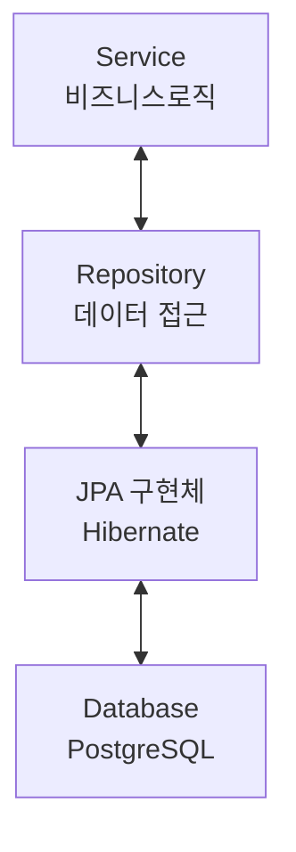

![[thumbnail.png]]

# Spring Data JPA란?



- Java Persistent API: Java 객체와 관계형 데이터베이스를 매핑하는 표준 API
- Hibernate: JPA를 구현한 대표적인 ORM 프레임워크
- Spring Data JPA: JPA를 더 편리하게 사용할 수 있도록 Repository 기반의 데이터 접근 기능을 제공

# 코드로 살펴보기

## `Entity`

- `@Entity` 어노테이션을 붙여 JPA 엔티티로 인식할 수 있게 한다.
- `@Id`는 해당 필드를 기본 키(Primary Key)로 지정한다.
- `@GeneratedValue`는 기본 키 생성 전략을 설정한다.
- `GenerationType.IDENTITY`는 ID 생성을 데이터베이스에 위임한다.

### AS-IS

```java
public class Post {
	private Long id;
	private String title;
	private String content;

	public Post(Long id, String title, String content) {
		this.id = id;
		this.title = title;
		this.content = content;
	}

	public Long getId() {
		return id;
	}

	public String getTitle() {
		return title;
	}

	public String getContent() {
		return content;
	}

	public void update(String title, String content) {
		this.title = title;
		this.content = content;
	}
}
```

### TO-BE

```java
import jakarta.persistence.Entity;
import jakarta.persistence.GeneratedValue;
import jakarta.persistence.GenerationType;
import jakarta.persistence.Id;

@Entity
public class Post {
	@Id
	@GeneratedValue(strategy = GenerationType.IDENTITY)
	private Long id;
	private String title;
	private String content;

	protected Post() {}

	public Post(String title, String content) {
		this.title = title;
		this.content = content;
	}

	public Long getId() {
		return id;
	}

	public String getTitle() {
		return title;
	}

	public String getContent() {
		return content;
	}

	public void update(String title, String content) {
		this.title = title;
		this.content = content;
	}
}
```

## `Repository`

- 기존 인터페이스를 `JpaRepository<Entity, ID>` 형식으로 확장한다.
- `JpaRepository`에는 기본적으로 CRUD 메서드를 제공한다.

### AS-IS

```java
import java.util.List;

public interface PostRepository {
	Post findById(int id);

	List<Post> findAll();

	void save(Post post);

	void delete(Post post);
}

@Repository
public class PostRepositoryImpl implements PostRepository { ... }
```

### TO-BE

```java
import org.springframework.data.jpa.repository.JpaRepository;

public interface PostRepository extends JpaRepository<Post, Long> {}
```

# 주요 메서드

> [!NOTE] Create/Update `save()`
>
> ```java
> Post post = new Post("Title", "Content");
> postRepository.save(post);
> ```

> [!Note] Read `findById()`
>
> ```java
> Optional<Post> post = postRepository.findById(1L);
> ```

> [!NOTE] Read `findAll()`
>
> ```java
> List<Post> posts = postRepository.findAll();
> ```

> [!NOTE] Delete `delete()`
>
> ```
> postRepository.delete(post);
> ```

그 외 메서드는 [공식 문서](https://docs.spring.io/spring-data/jpa/docs/current/api/org/springframework/data/jpa/repository/JpaRepository.html)를 참고한다.

# Query Method

메서드 이름을 기반으로 자동으로 쿼리를 생성한다.

```java
import org.springframework.data.jpa.repository.JpaRepository;
import java.util.List;
import java.util.Optional;

public interface PostRepository extends JpaRepository<Post, Long> {

    // 제목으로 게시글 조회
    // SELECT * FROM post WHERE title = ?;
    List<Post> findByTitle(String title);

    // 제목에 특정 문자열이 포함된 게시글 조회
    // SELECT * FROM post WHERE title LIKE ? ESCAPE '\';
    List<Post> findByTitleContaining(String keyword);

    // 제목에 특정 문자열이 포함된 게시글 개수
    // SELECT COUNT(*) FROM post WHERE title LIKE ? ESCAPE '\';
    long countByTitleContaining(String keyword);

    // 제목으로 게시글 존재 여부 확인
    // SELECT EXISTS (SELECT 1 FROM post WHERE title = ?);
    boolean existsByTitle(String title);

    // 제목으로 게시글 삭제
    // DELETE FROM post WHERE title = ?;
    void deleteByTitle(String title);
}
```

# 트랜잭션

여러 데이터베이스 작업을 하나의 논리적 작업 단위로 처리한다.
Spring에서는 `@Transactional`을 사용해 트랜잭션 범위를 정할 수 있다.

> [!example] 계좌 이체
> 계좌 이체는 출금과 입금이 모두 성공해야 한다. 만약 A 계좌에서 출금이 되었는데 모종의 이유로 B 계좌에 입금에 실패한다면 A 계좌의 출금을 취소되어야 한다.
>
> ```java
> import org.springframework.stereotype.Service;
> import org.springframework.transaction.annotation.Transactional;
>
> import java.math.BigDecimal;
>
> @Service
> public class AccountService {
>
>     private final AccountRepository accountRepository;
>
>     public AccountService(AccountRepository accountRepository) {
>         this.accountRepository = accountRepository;
>     }
>
>     @Transactional
>     public void transfer(
>             Long fromId,
>             Long toId,
>             BigDecimal amount
>     ) {
>         if (fromId.equals(toId)) {
>             throw new IllegalArgumentException(
>                     "출금 계좌와 입금 계좌가 같을 수 없습니다."
>             );
>         }
>
>         if (amount.signum() <= 0) {
>             throw new IllegalArgumentException(
>                     "이체 금액은 양수여야 합니다."
>             );
>         }
>
>         Account from = accountRepository.findById(fromId)
>                 .orElseThrow(() ->
>                         new IllegalArgumentException("출금 계좌가 없습니다.")
>                 );
>
>         Account to = accountRepository.findById(toId)
>                 .orElseThrow(() ->
>                         new IllegalArgumentException("입금 계좌가 없습니다.")
>                 );
>
>         from.withdraw(amount);
>         to.deposit(amount);
>     }
> }
> ```
