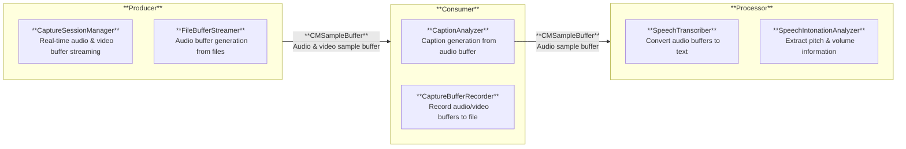

![[thumbnail.png]]

### Adopting Swift Concurrency to Resolve Data Race Issues in Asynchronous Workflows

To prevent bottlenecks while processing real-time buffer streams from microphone input, operations must run asynchronously. We leveraged `AsyncStream` to asynchronously produce audio buffer chunks, allowing the processing pipeline to subscribe and consume them concurrently. Furthermore, to prevent potential Data Race issues when caching analyzed caption results, the cache store was implemented as a Swift `Actor` to guarantee serialized, thread-safe access to internal properties.

### Unifying Audio Buffer Pipelines from AVAudioEngine to AVCaptureSession

Initially, microphone-only recording utilized `AVAudioEngine` with tap-installed `AVAudioPCMBuffer` analysis, whereas combined camera-microphone recording used `AVCaptureSession` with `CMSampleBuffer`. This dual-pipeline architecture raised the risk of inconsistent analysis results for identical sound sources. To eliminate discrepancies, the architecture was unified to process all real-time audio streams through `AVCaptureSession` and `CMSampleBuffer`.
