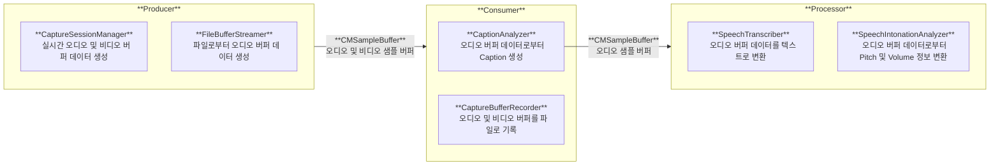

![[thumbnail.png]]

### 비동기 작업 시 Data Race 문제를 해결하기 위한 Swift Concurrency 도입

마이크 녹음으로 생성되는 버퍼 데이터를 가지고 실시간 처리를 할 때 병목 현상을 막기 위해서는 비동기로 작업을 수행해야 합니다. 이를 위해 버퍼 데이터를 AsyncStream을 통해 비동기적으로 생산하고, 이를 처리하는 파이프라인에서 구독하여 비동기로 처리하도록 구현하였습니다. 또한 처리된 데이터를 캐시에 저장할 때 발생할 수 있는 Data Race 문제를 방지하기 위해 Actor로 선언하여 내부 프로퍼티에 안전하게 순차 접근하도록 설계하였습니다.

### 실시간 오디오 버퍼 데이터 수집을 AVAudioEngine 기반에서 AVCaptureSession으로 전환

초기 개발 시 마이크 단독 녹음에는 AVAudioEngine 탭을 설치하여 AVAudioPCMBuffer를 분석하고, 카메라 동시 녹화 시에는 AVCaptureSession을 사용하여 CMSampleBuffer 기반으로 분석하도록 이원화되어 있었습니다. 이로 인해 두 개의 독립적인 파이프라인이 생성되어 동일한 오디오 데이터임에도 서로 다른 분석 결과를 도출할 위험이 있었습니다. 이러한 파이프라인 불일치 문제를 해결하기 위해, 마이크 단독 녹음 환경에서도 AVCaptureSession을 기반으로 일관되게 CMSampleBuffer를 수집·처리하도록 통합하였습니다.
