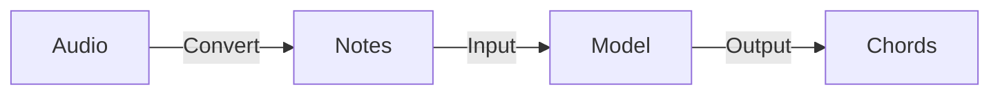

![[thumbnail.png]]

### Designing, Training, and Deploying an On-Device AI Model for Chord Inference

To ensure the app operates offline without server costs, the pipeline was engineered entirely for on-device inference. Audio signals are first preprocessed into discrete note events, which feed into the inference model. Balancing mobile memory and compute limits, we trained a lightweight Transformer architecture. The training corpus was constructed by parsing and tokenizing MusicXML sheet scores. To execute the PyTorch model on iOS, we converted and quantized it into Core ML (.mlpackage) using `coremltools`.



```swift
// Model input token structure (adapted from REMI format)
[Position_0, Note_C, Duration_5, ...]
```

### Music Domain Data Modeling

We designed structured domain models rooted in music theory and sheet notation. Based on these domain definitions, class hierarchies and protocols were established to coordinate playback and analysis workflows across team members seamlessly.

![[data-modeling.png]]

### Virtual Instrument Chord Playback using AVFoundation

Using `AVAudioSequencer`, chord progression data is dynamically scheduled onto audio sequence tracks. An `AVAudioUnitSampler` then loads sound font (.sf2) instruments to synthesize realistic, rich polyphonic harmony directly through the device's audio output.
