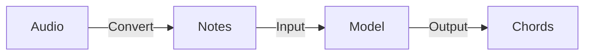

![[thumbnail.png]]

### 멜로디에서 코드를 추론하는 AI 모델 설계, 학습 및 적용

서버 없이 온디바이스에서 독립적으로 구동되는 것을 목표로 하였습니다. 이를 위해 오디오 데이터를 먼저 전처리하여 음표 데이터로 변환한 뒤, 이를 모델의 입력으로 사용하는 추론 파이프라인을 설계하였습니다. 제한된 모바일 메모리와 연산 성능을 고려하여 아이폰에서 원활히 작동하도록 경량 Transformer 모델을 기반으로 학습을 진행하였습니다. 학습 데이터는 MusicXML을 파싱하여 모델의 입력 형식에 맞게 전처리하였습니다. 이후 학습된 PyTorch 모델을 iOS 온디바이스 환경에서 구동하기 위해 `coremltools`를 활용해 Core ML(.mlpackage) 포맷으로 변환 및 최적화하였습니다.



```swift
// 모델의 입력으로 사용된 토큰 형식(REMI 기반으로 변형)
[Position_0, Note_C, Duration_5, ...]
```

### 음악 도메인 데이터 모델링

실제 음악 이론 도메인에서 사용되는 전문 용어와 악보 구조를 기반으로 데이터 모델을 정밀하게 설계하였습니다. 이를 바탕으로 내부 로직 처리에 필요한 클래스 구조와 인터페이스를 정의하고, 팀원들과 역할을 나누어 체계적으로 개발을 진행했습니다.

![[data-modeling.png]]

### AVFoundation 프레임워크를 활용한 가상 악기 코드 재생

`AVAudioSequencer`를 사용하여 추론된 코드 시퀀스 데이터를 오디오 트랙에 동적으로 추가하고, `AVAudioUnitSampler`를 통해 사운드폰트(.sf2) 음원을 로드하여 가상 악기로 풍부한 화음 사운드를 재생하는 엔진을 구축하였습니다.
